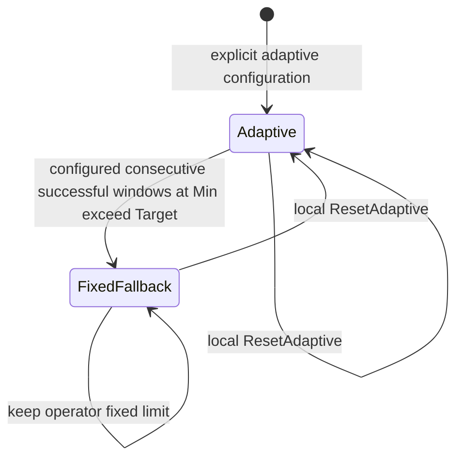

# R8A：RPC 控制器回退与复位

持续低并发仍超出延迟目标时，服务端可按明确配置切换固定限额，并由操作人员复位。该机制扩展现有 AIMD 与反馈路径，沿用原协议。

| 步骤 | 实施 | 验收 |
| --- | --- | --- |
| A1 | 保存 R7C 源码并跑原 AIMD/反馈/固定并发基线 | 20ms 固有耗时/5ms 目标，真实双进程 fixture，保留全部 offered |
| A2 | 方法配置 FallbackLimit/FallbackWindows，连续最低限额成功窗口仍超目标时锁定为固定限额 | 默认关闭保护；取消中性，显式失败不得触发上调回退；合法范围、状态和有界决策日志 |
| A3 | 人工 ResetAdaptive；样本 generation 隔离 | 旧在途请求不污染复位后窗口；不抢占现有处理器；与排队/关闭/取消和压力反馈一致 |
| A4 | 固定 4/8/16、原 AIMD、原反馈、保护、保护+反馈的串行对照及完整回归 | 低负载、稳态、容量切换、目标不满足；普通/race、fuzz、真实 etcd、三种传输、资源归零 |

FallbackLimit 由服务端显式配置，并受 Min/Max/global cap 限制。达到条件后保持固定并发，人工复位后恢复自适应，避免自动来回切换。固定值应结合工作量和静态基线选择，错误配置可能降低容量或增加延迟。

## 配置及行为

```go
cfg := kanarpc.ServerConfig{
    Governance: &kanarpc.GovernanceConfig{
        Adaptive: true, Feedback: true,
        MaxExecuting: 16, SampleWindow: 16,
        Methods: []kanarpc.MethodPolicy{{
            Method: "/demo/analyze",
            Min: 2, Initial: 16, Max: 16,
            Target: 10*time.Millisecond,
            FallbackLimit: 4,    // operator-chosen static configuration
            FallbackWindows: 3,
        }},
    },
}
// Construct server, register /demo/analyze, and Serve as usual.
// A trusted local operator may explicitly resume an adaptive experiment:
// err := server.ResetAdaptive("/demo/analyze")
```

`FallbackLimit=0` 默认关闭保护，保持原 AIMD 行为。开启时必须 `Adaptive=true`、`Min≤FallbackLimit≤Max≤MaxExecuting`；FallbackWindows 默认 3，范围 1..64，未配置限额不能单独指定窗口数。配置数组复制，Serve 时仍验证方法存在。

仅在**已经处于 Min** 的完整有效样本窗口中，p90 仍大于 Target，且窗口没有执行错误，才增加连续窗口计数。触发阈值后切换为 `fixed_fallback` 并使用配置的固定限额。用户取消不计入样本、不推进或打断连续计数。处理器返回的 ResourceExhausted、Unavailable、deadline、Internal、InvalidArgument 等错误会抑制当期回退，避免把失败窗口用作上调并发的依据；原 AIMD 的显式过载降并发仍保留。

排队超时不属于处理器驻留时间，也不参与成功窗口；它仍按原契约取消队列工作。成功窗口变慢可能来自拥塞、外部依赖或信用等待，均可能满足回退条件。因此该机制按配置执行回退，诊断时应结合队列、依赖和负载指标选择 FallbackLimit。



## 人工复位与资源边界

`ResetAdaptive(method)` 是本进程 API，没有注册为远端管理方法，没有自动业务重试。它将方法恢复到 Initial，清空窗口和连续计数、递增 generation/resets 并记录 `operator_reset`。现有请求保持执行名额，降低限额也不会强制抢占处理器；增加容量后只调度已接纳队列。服务端仍执行全部 global/method/in-flight/byte 边界。

每个处理器获得执行槽时记录 generation，复位前已经启动的请求仍正常完成、回收并响应，但不采入复位后的控制窗口。复位后才获得槽的已排队请求使用新 generation。此操作不重放请求、不改 Context、不取消 ACK/FIN 等待；draining 返回 ErrDraining、closed 返回 ErrClosed，未知方法或未开启自适应返回明确错误。

固定回退不会自动恢复自适应，即使后来延迟改善也保持固定，避免后台振荡，但可能浪费恢复后的容量。人工复位必须基于新的诊断；反复复位错误目标会重新触发相同行为。既有客户端建议不会立即撤销，只能等下一条 END/TTL；服务端限额一直是最终接纳约束。

`Governance()` 每方法暴露 Mode、UnmetWindows、Generation、Fallbacks、Resets 及原 Limit/Running/Queued/Samples/P90。决策环保留 128 条，包含 previous/next mode 和 generation；人工复位即使没有改变数值也记录。Samples 是跨 generation 的累计有效样本数，复位清空当前窗口与 P90，不清零累计数。固定回退期间仍采样和更新 P90，保持诊断能力，但不自动改限额。

## 对照与复跑

```sh
python3 scripts/verify-discovery.py --output /tmp/kanarpc-r8a-test
python3 scripts/verify-discovery.py --output /tmp/kanarpc-r8a-race --race
go test . -run='^$' -fuzz='^FuzzAdaptiveGuard$' -fuzztime=15s -parallel=2
python3 scripts/verify-governance.py --output /tmp/kanarpc-r8a-control --cross-transport
```

当前 runner 在原五组上补 `fixed8-fair`、`guarded`、`guarded-feedback`，共八组，默认 4 场景 × 3 种子 = 96 TCP case，外加 6 TLS/QUIC case。guarded 使用 FallbackLimit=4、FallbackWindows=3；固定 8 是额外自然静态基线，不能只比较容易获胜的固定高并发或错误静态值。不同 case 使用独立进程，完整 offered、拒绝、超时、成功延迟、按时完成量、CPU、决策和资源尾部保留。

评估时同时比较完成总量、拒绝、延迟与合适的静态限额。本阶段本地结果见 [R8A 报告](verification/control-r8a/report.md)，统一环境说明见 [使用约束](operating-notes.md)。
