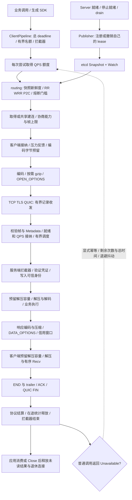

# 业务接入与完整 RPC 调用链

KanaRPC 的业务入口是 `ServiceCaller`：直连客户端、发现连接池和生成 SDK 使用同一条调用路径。`ClientPipeline` 在这条路径上组织凭证、观测、尝试限流与显式重试；服务端在有界 worker 中执行拦截器、鉴权、解压和业务方法。底层继续使用原有取消、信用窗口、终态回执与字节租约。

## 功能与职责

| 环节 | 能力 | 代码 |
| --- | --- | --- |
| 调用上下文 | 有界请求 Metadata、响应 trailer、已验证身份与传输 Peer | [metadata.go](../metadata.go)、[security.go](../security.go) |
| 客户端入口 | 普通/服务端流共用管线，拦截器一次进入与反向结束，尝试额度、总 deadline、显式幂等重试 | [pipeline.go](../pipeline.go)、[middleware.go](../middleware.go) |
| 编码与压缩 | JSON/Protobuf、能力协商、按消息 gzip、压缩后不更小时回退原文、编码与解压预算 | [compression.go](../compression.go)、[preparation.go](../preparation.go) |
| 服务端执行 | 按方法调度后进入中间件和 Authenticator，鉴权后解压/解码，再调用业务方法 | [server.go](../server.go) |
| 实例选择 | RR、平滑 WRR、P2C；独立协议在途统计，调权保持连接身份 | [routing/policy.go](../routing/policy.go) |
| 故障隔离 | endpoint 熔断、单半开探测、代次隔离、累计转换/拒绝统计，建连退避独立保留 | [routing/client.go](../routing/client.go) |
| 就绪与发布 | Health Check/Watch、应用设置就绪、Publisher 发布/撤销自己的 etcd lease | [health.go](../health.go)、[discovery/publisher.go](../discovery/publisher.go) |
| 运维观测 | 结构化日志、Prometheus 文本指标、OpenTelemetry span/metric 与 traceparent 传播 | [metrics.go](../metrics.go)、[observability](../observability/otel.go) |
| 连接生命周期 | 显式 TCP keepalive、QUIC keepalive、空闲连接退休、drain 与关闭等待 | [options.go](../options.go)、[quic.go](../quic.go) |
| 调试入口 | JSON/Protobuf 调用、JSON 行格式流式输出、健康与方法查询 | [cmd/kanarpc](../cmd/kanarpc/main.go) |

## 一次调用如何完成



连接能力只在建连时协商，请求复用结果。重试回到“尝试额度与选址”，不会为一次逻辑调用反复执行外围拦截器，也不会获得新的总时间预算。流式调用不自动重试。队列、执行、协议收尾和应用未读引用各自统计，协议完成不等于消费完成。

### 客户端

1. 业务通过生成 SDK 调用 `ClientPipeline`，拦截器在编码前传递调用凭证与追踪上下文。
2. 每次普通调用尝试、每次流创建均取得令牌桶额度；额度不足返回本机 `RateLimitError`。重试也消耗额度。
3. 发现连接池检查 snapshot 的 revision、cluster 和新鲜度，选择符合退避/熔断门槛的 endpoint。共享建连继续受连接上限和拨号超时约束。
4. 根客户端取得在途与编码名额，检查能力和 Metadata，再进行 Size/Marshal 和 gzip。所有准备工作计入剩余 deadline。
5. 帧上限检查和发送字节预留通过后写 OPEN。QUIC 在准备完成后才分配业务流。

### 服务端与响应

1. 读循环先校验固定头与帧大小、预留记录空间，再读取正文。新请求解析有界 Metadata，与 CANCEL/CREDIT/ACK 的控制处理分开。
2. 就绪、业务 QPS、全局/连接在途和队列门槛共同决定接纳。控制消息不消耗业务 QPS 额度，仍使用控制字节预算。
3. 被调度的 worker 进入服务端拦截器。`Authenticate` 验证凭证后创建 `Identity`；调用方自报的字段不能直接成为可信身份。`PeerFromContext` 提供经过配置的 TCP/TLS/QUIC 连接信息。
4. gzip 请求在解码前取得展开容量，随后构造业务消息。响应复用 Sender 的信用窗口、序号与取消机制，每条消息独立决定压缩。
5. 客户端先预留解压空间再展开正文，数据按原序号交给 Recv；取消中的解压只清理当前帧，不把正常取消升级为共享连接故障。
6. END 携带状态、可选 trailer 和协议 receipt。ACK/QUIC FIN 沿用原结算规则，累计交付故障不清零。协议在途与连接租约分开结束，未读结果持续计费。

## 接入方式

```go
// cfg 用于直连或 routing.Config.Dial.Client。
cfg := kanarpc.ClientConfig{
    RequiredFeatures: kanarpc.FeatureProtobuf | kanarpc.FeatureServerStreaming,
    EnableCallOptions: true,
    Compression: &kanarpc.CompressionConfig{MinBytes: 1024},
}
// raw 可以是直连 *Client、*QUICClient 或 *routing.Client。
pipe, err := kanarpc.NewClientPipeline(raw, kanarpc.PipelineConfig{
    Timeout: 5 * time.Second,
    RateLimiter: requestQuota,
    Interceptors: []kanarpc.Interceptor{
        telemetry, metrics.Interceptor(),
        kanarpc.Credentials(credentialProvider),
    },
    Retry: kanarpc.RetryPolicy{
        MaxAttempts: 2,
        IdempotentMethods: []string{"/app.catalog.Catalog/Get"},
    },
})
// 检查 err 后，把 pipe 传给生成的 New...Client。
```

`ClientPipeline` 成功创建后拥有底层 caller 的关闭职责。`Close` 封闭接纳并取消调用；`Wait(ctx)` 等待已接纳管线与拦截器结束，关闭后还会调用底层 routing 的 Wait，保留用户持有的流租约。应用应消费流至 EOF 或显式 Close。

拦截器返回的新 Context 继续向下传递，结束回调逆序且只运行一次，不在框架互斥锁中执行。鉴权、拦截器、日志输出和用户编解码都是协作式代码；阻塞时会保留对应名额，等待接口如实报告未结束工作。

每次调用可以创建单独的 `MetadataCapture`，用 `CaptureTrailers(ctx, capture)` 获取 END 中的响应元数据。`SetTrailer` 只允许在选项调用的处理器中设置有界 trailer；它不是初始响应 header。不要把同一个 capture 用于需要分别关联结果的并发调用。

## 健康、发现与发布

```go
server.SetServing(false) // 依赖未准备好；监听就绪仍可通过 Ready 判断。
// 注册业务、可选 RegisterHealth / RegisterIntrospection，并启动 Serve。
publisher, err := registry.Publish(ctx, server, service, endpoint, 5, 50*time.Millisecond)
// 检查 err，完成业务初始化后：
server.SetServing(true)
// 发布前可用 publisher.WaitReady(ctx) 等待自己的 lease 就绪。
// 退出：SetServing(false)，publisher.Close(ctx)，再 DrainWithReport(ctx)。
```

Publisher 有独立容量上限，注册、撤销和退出由 Registry 所有权管理。应用停止就绪、开始 drain 或关闭后会撤销自己的 lease，现有调用仍由原服务器与连接租约收尾。Publisher.Close 和 Registry.Close 可等待清理结果；etcd 不可达时会返回失败，不能把本地停止等同于已经远端撤销。

RPC 健康 Check/Watch 与方法查询均为显式注册的 JSON 服务，走同一鉴权入口。另可将 `HealthHandler` / `Metrics` 绑定到应用自己的管理 HTTP listener。方法查询不是 gRPC reflection，KNR2 CLI 不假定 grpcurl 协议兼容。

TCP keepalive、QUIC keepalive 和业务 deadline 分别配置。保活证明连接状态，不证明业务依赖已就绪；`IO.ReadTimeout` 仍限制一帧与静默等待，长流需按实际静默区间配置。

## 路由与故障策略

- RR 为默认策略；WRR 用 endpoint ID 绑定权重，`SetWeights` 不改变 endpoint 身份、不触发重连。
- P2C 抽取两个合格 endpoint，以独立协议在途计数选择。配置权重时比较归一化在途分数，不承诺 WRR 式的固定请求比例。未读引用、正在拨号的引用和连接 users 不直接作为执行负载。
- 熔断按 endpoint 维护有界请求样本窗口；默认只统计可归因通信故障，`CountUnavailable` 可选纳入远端 Unavailable。调用方取消、deadline、本地预算/QPS/路由拒绝不计后端失败。它不能从一个状态码推断具体故障原因。
- 半开只允许一个探测；状态代次和 endpoint 对象身份隔离迟到结果。累计 CircuitRejected/Opened/Recovered 单独保留；服务端交付故障统计保持原有语义。
- 所有 endpoint 不合格时快速返回可识别的路由错误，routing 不重放业务。只有显式幂等声明的普通调用可由外围管线重试 Unavailable，最多五次、指数退避与抖动、共用总 deadline。流式调用始终一次派发。
- 多次尝试使用独立响应对象，成功后才写入调用者响应，避免失败解码遗留字段。框架不生成业务幂等键、不提供事务去重或副作用回滚。

## 压缩与资源口径

启用 `CompressionConfig` 同时启用调用选项协商；对端支持该选项格式即支持 gzip 解码，服务端 CompressionConfig 控制响应是否尝试压缩。双方阈值可不同。不压缩控制记录，压缩无收益时发送原文。逐消息创建压缩器带来 CPU 与分配成本，是否启用应结合正文可压缩性和链路容量决定，测量见 [验证报告](verification/production-r15/README.md)。

客户端编码预留包含两个最大帧、8 KiB 元数据临时容量及启用 gzip 时的 2 MiB 写工作空间；完成准备后缩减为实际保守持有。发送侧覆盖原文、压缩结果、封装和写 packet 的同时持有。接收侧在展开前预留声明明文长度与 128 KiB 读工作空间，成功后缩减到明文长度，直到消费/关闭后释放。明文与线上帧均受上限约束；长度不符、CRC 错误、额外 gzip member 或尾随字节拒绝。

`CompressionStats` 的 Prepared/GzipPrepared 和字节量表示准备的业务正文，排除元数据、帧头、加密与网络重传，不等于成功送达或应用消费。解码业务对象、Metadata/身份对象、Go allocator 和传输内部内存仍需单独观察，字节租约不等于 RSS 上限。

## 观测与调试

`Metrics` 可直接作为 HTTP handler，导出调用次数、尝试数、延迟 histogram、队列/执行/在途状态、预算、QPS 拒绝、压缩准备字节及累计交付故障。series 有界，身份、凭证、请求 ID 和正文不作指标标签。

`observability.Interceptor` 接入应用提供的 OTel TracerProvider、MeterProvider 和 Propagator；默认传播 W3C traceparent。应用拥有 exporter、采样、导出队列和 provider shutdown。日志适配器把 trace_id/span_id 与方法、状态、耗时关联，不输出凭证或正文。

客户端流 span 的结束点是协议终态；应用未读数据仍被记账。客户端业务解码错误另计入 `ClientStats.DecodeErrors`。服务端 hook 覆盖已调度 worker 的鉴权、解码、执行和发送，排队等待另有指标；未进 worker 的接纳拒绝由 ServerStats、预算和限流计数体现。已有本地 TraceRecorder 继续负责细粒度请求决策时间线。

```sh
# 一条命令运行实际本机 RPC、类型化 SDK、压缩、取消、观测与 drain。
go run ./cmd/production-demo
go run ./cmd/production-demo -transport quic
# 配置真实单成员 etcd 后运行相同链路。
go run ./cmd/production-demo -transport tls -etcd http://127.0.0.1:2379

# 保持服务运行，凭证通过环境变量提供。
go run ./cmd/production-demo -mode server -listen 127.0.0.1:9090 -ready /tmp/production-ready.json
# 用 ready 中的实际地址；TLS/QUIC 另传 -ca 与 -server-name。
go run ./cmd/kanarpc -token-env KANARPC_DEMO_TOKEN -address 127.0.0.1:9090 -mode methods
go run ./cmd/kanarpc -token-env KANARPC_DEMO_TOKEN -address 127.0.0.1:9090 -mode health
# JSON 方法；Protobuf 方法使用本地 FileDescriptorSet。
go run ./cmd/kanarpc -token-env KANARPC_DEMO_TOKEN -address 127.0.0.1:9090 -method /demo/json -request '{"hello":"world"}' -gzip
go run ./cmd/kanarpc -token-env KANARPC_DEMO_TOKEN -address 127.0.0.1:9090 -descriptor api/schema.binpb \
  -method /kanarpc.examples.EchoService/Watch -request '{"text":"hello","count":3}'
```

两个进程模式要求设置 `KANARPC_DEMO_TOKEN`，CLI 用 `KANARPC_TOKEN` 或 `-token-env KANARPC_DEMO_TOKEN`。示例的 CA、令牌和计时负载服务于本机验证；部署时注入实际信任与身份验证策略。外部身份平台、远程 OTel collector、真实双机/WAN、小时级负载及模型推理需要各自环境验收。

完整的本轮复现、失败修正与结果见 [R15 验证报告](verification/production-r15/README.md)。
