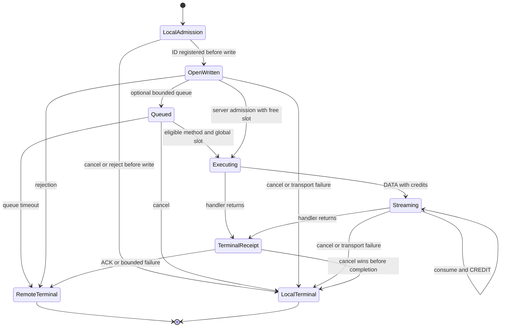

# 独立内核重写计划

2026-10-31。目标是重新设计一个可解释、能承载原项目特色功能的 RPC 内核，保留旧目录作为历史证据和行为对照。旧设计是否适用取决于契约、组件耦合和验证结果，不能仅根据年代判断。

本轮核对的旧公开接口覆盖了 CampusTrace 普通分析调用、可选推理桥接的服务端流、用户取消及上层 SQL 任务恢复。任务恢复与权限仍由 CampusTrace 应用负责；RPC 不重放已发送业务，不提供 exactly-once。日常模型 API 路径不因内核重写而改变。

## 阶段与验收门槛

| 阶段 | 实现内容 | 验收门槛与迁移边界 |
| --- | --- | --- |
| R7A，已完成 | 独立 v2 帧、显式类型注册、统一普通/流式生命周期、信用流控、默认取消、有限接纳、终态回执、deadline drain、资源统计 | 历史验收见 core-r7；R7B 继续保留并补充回归 |
| R7B，已完成 | TLS 构造与信任配置；以一次请求交换为边界接原生 QUIC；明确物理 session 和请求资源统计；etcd 快照/增量/lease 的独立实现 | 具体步骤、API、验证与边界见 [transport-r7b.md](transport-r7b.md) |
| R7C，已完成 | 跨流字节预算，按方法有限调度和权重，延迟窗口 AIMD，压力反馈版本/TTL/epoch，客户端可选接纳 | 具体配置和验收见 [governance-r7c.md](governance-r7c.md)；保留固定低并发优胜与目标不可达退化；租户身份公平尚未实现 |
| R7D，暂缓 | SDK 接入边界，迁移推理 worker/gateway 与 CampusTrace 适配 | 用户正在重构 CampusTrace，当前优先 RPC 本身，不改 CampusTrace 配置、依赖或业务 |
| R8A，已完成 | 自适应控制回退：持续最低并发仍超目标时，按服务端明确配置切换固定限额，记录状态并支持人工复位 | [配置与步骤](control-r8a.md)、[报告](verification/control-r8a/report.md)；保留固定 8 优胜、容量切换小幅退化；不宣称自动证明目标不可达 |
| R8B，后续 | 编码前客户端并发接纳、编码结果字节约束、长期资源曲线 | 慢/恶意编码器、取消与关闭、goroutine/heap/GC；区分编码结果上限与任意编码函数内部内存 |
| R8C，后续 | 发现驱动连接生命周期与独立 SDK 消费 | endpoint 更新/删除、旧连接退休、在途保护、连接建立去重；不隐式重放业务 |
| R8D，后续 | RPC 独立故障与网络验收 | Linux 双机 TCP/TLS/QUIC、RTT/丢包/限带宽、长流/慢消费者、etcd 多成员；环境缺失时明确未验证 |

R7A 的通过只代表第一阶段。不会为兼容旧包名而调用旧 internal，也不会自动把旧测试结果搬成新版本结果。新协议不做隐式 downgrade；真正迁移时新旧端点显式分离。

## 已落实的架构选择

- **注册边界**：`RegisterUnary[Req, Resp]` / `RegisterStream[Req, Resp]`，编译期检查处理器签名；底层 RawMessage 入口允许显式处理 JSON。没有反射服务方法发现，没有忽略 Context 的旧方法形态。
- **资源归属**：应用创建 listener，第一次成功 Serve 后交给 Server；Client 拥有一次 Dial/NewClient 转交的连接。Server 统计处理器、连接 reader 和终态等待者；Client.Close 等待自己的 reader 和取消回调。
- **请求终态**：本地取消、传输失败、远端终态用锁保护的单次完成竞争；本地取消丢弃未读块，远端终态允许先消费已经接收的块。
- **有界接纳**：同时限制服务端总请求、每连接请求、物理连接、客户端在途请求、帧大小和逐流信用。满载不创建处理器 goroutine；处理器或信用等待不占用控制 reader。同步拒绝写仍可能受慢 socket 阻塞，最终由写期限收敛。
- **连接损坏语义**：只等待写锁时取消不伤连接；部分记录写失败会关闭整个有序字节流，不能假装仅影响一个 TCP 请求。取消从未写出的 Open 不发送未来 ID 控制帧。
- **关闭**：drain 与接纳共用同一把状态锁；先封闭接纳，等待已接纳请求及正常终态 ACK，再回收连接。截止后返回错误并取消资源，忽略 Context 的用户函数仍保留在统计中。

服务端的处理器返回、协议回执送达和应用消费是不同事件。回执不承诺数据库提交；上层任务在进程故障后仍可能 UNKNOWN。

## 当前必须保留的风险

TCP 写阻塞或坏帧会影响同一连接上的多个请求；R7B 用 QUIC 分流做隔离实验。R7C 用共享字节租约限制框架持有的记录缓冲，但用户对象、编码器、TLS/QUIC 内部、Go heap/RSS 仍不受该预算覆盖。已经结束而未消费的 Stream 继续计费，调用者应消费或 Close；仅凭在途数量不能判断全部内存。

配置超时从请求编码前开始计费，但不能强制中断用户的 MarshalJSON 或处理器。相对预算避免要求机器时钟相同；服务端不扣除单向网络传输时间，因此取消未送达时不保证与客户端同一时刻停止。读超时是完整一帧的时间上限，也限制长时间静默请求，不是心跳或自适应空闲探测。

R7B 提供显式 TCP/TLS/QUIC 与有新鲜度门槛的发现，R7C 接入方法治理与反馈，R8A 增加显式配置回退与人工复位；没有方法 ACL、租户身份、发现驱动连接池或熔断。反馈是可过期建议，多连接可能超卖；未开启保护的 AIMD 对不可达目标仍会退化，保护也受固定值与采样影响，不承诺普遍收益。真实 vLLM/GPU 继续标注未验证。
