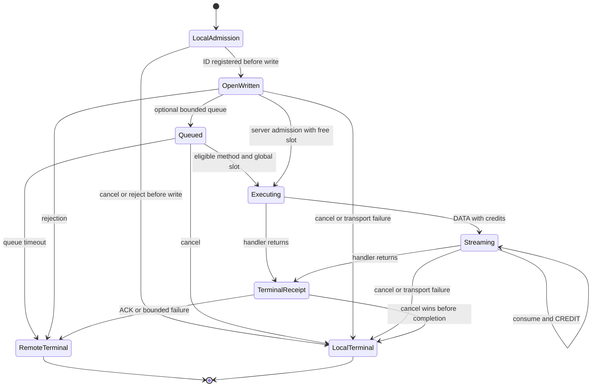

# 架构与演进

KanaRPC 围绕上下文、请求状态和资源归属组织内核。普通调用与服务端流式调用共享生命周期；传输、发现与连接管理通过明确的接口和所有权组合。实现沿革见 [ORIGINS](../ORIGINS.md)。

## 模块职责

| 模块 | 职责 |
| --- | --- |
| 根包 | 泛型与 Protobuf 注册、Call/Stream、取消与预算、传输适配、调度、回执结算和资源统计 |
| `internal/wire` | KNR2 帧校验、有界读写与预算预留 |
| `discovery` | etcd lease 所有权、revision 快照、watch 恢复与新鲜度 |
| `routing` | 快照门槛、建连去重、连接上限、退休引用与共享字节池 |
| `cmd/protoc-gen-kanarpc` | 从 schema 生成类型化客户端、流接收器与原子服务注册 |
| `cmd/showcase` | 可调负载、流式操作、关闭报告和本地请求时间线 |

## 请求生命周期

处理器通过 `RegisterUnary[Req, Resp]` / `RegisterStream[Req, Resp]` 显式注册，签名包含 `context.Context`。底层 RawMessage 入口用于直接处理 JSON。客户端在调用用户编码器前取得名额与编码容量；QUIC 完成准备后再分配业务流。

Protobuf 服务由 `.proto` 生成类型化客户端与注册入口，使用二进制业务正文；JSON 与 Protobuf 共用接纳、信用窗口、回执与连接退休机制。生成 SDK 通过 `ServiceCaller` 同时接入直连和 `routing.Client`，细节见 [Protobuf 与 Go SDK](protobuf.md)。

服务端分别记录排队、执行与终态等待。请求发送 DATA 前消耗信用，消费后归还信用；处理器返回后通过 END、ACK 与 QUIC FIN 完成协议收尾。本地取消、远端终态与传输失败通过一次性终态竞争收敛，迟到响应按请求 ID 处理。

## 关键工程选择

- **显式所有权**：应用创建 listener，成功 Serve 后交给 Server；Client 拥有 Dial/NewClient 转交的连接。Close 负责 IO 收尾，Wait/WaitIdle 观察残余工作。
- **分层接纳**：服务端总请求、每连接请求、执行槽、队列、客户端准备名额与逐流信用分别有界；编码和记录缓冲通过原子字节租约管理。
- **完整资源计费**：连接进入退休状态后保留未读流、进行中的用户解码与编码租约，直到实际持有结束。池统计分别提供活跃与退休明细。
- **传输故障边界**：TCP/TLS 使用共享有序记录流，部分写入损坏后关闭该记录连接；QUIC 将每次请求放在独立原生流上，父会话负责共同资源和关闭屏障。
- **发现驱动管理**：routing 消费 revision/cluster/新鲜度合格的快照，去重建连并计入 dialing/retiring/closing 上限；失效时停止新路由，已有工作保留所属连接。
- **压力反馈控制**：服务端方法权重与延迟窗口决定执行上限，短效建议辅助客户端接纳；显式固定回退和人工复位提供可操作的控制路径。
- **可核查关闭**：drain 与接纳共用状态锁，先封闭接纳，再等待执行与回执；返回报告分别保留资源状态、累计故障与本次新增故障。

业务幂等、鉴权、协作取消、ACK 语义及资源预算范围统一见 [使用约束](operating-notes.md)。

## 阶段交付

| 阶段 | 交付内容 | 说明与验证 |
| --- | --- | --- |
| R7A | v2 帧、类型注册、普通/流式生命周期、信用流控与回执 | [内核报告](verification/core-r7/report.md) |
| R7B | TLS、原生 QUIC、会话屏障与 etcd 注册发现 | [传输与发现](transport-r7b.md) |
| R7C | 字节租约、方法加权调度、AIMD 与客户端反馈 | [过载治理](governance-r7c.md) |
| R8A | 显式固定限额回退、人工复位与 generation 隔离 | [控制回退](control-r8a.md) |
| R8B | 编码前接纳、编码容量预留与周期资源观察 | [准备资源](resources-r8b.md) |
| R8C | 建连去重、有界连接、endpoint 退休与独立 SDK 消费 | [连接管理](connections-r8c.md) |
| R8D | Darwin UDP 地址族冲突修复、故障取消与 netem | [网络诊断](network-r8d.md) |
| R9A | 池级共享预算、退休账户与未读子集统计 | [共享预算](pool-r9a.md) |
| R9B | deadline 感知原子批量与安全 paced 写回退 | [QUIC 发送](quic-r9b.md) |
| R9C | 类型化预算拒绝、累计结算与 DrainWithReport | [关闭契约](drain-r9c.md) |
| R9D | 小请求配对复验、收尾 profile 与候选评估 | [诊断结果](quic-r9d.md)：原降幅未稳定复现，三个候选全部撤回 |
| R10 | 有界事件日志、可调负载控制台、取消与关闭流程 | [操作指南](showcase-r10.md) |
| R11 | Protobuf 二进制业务编码、类型化 SDK 与组件升级 | [接入指南](protobuf.md)、[组件评估](components-20261101.md) |
| R12 | 建连能力协商、schema 兼容检查与 SDK 发布候选链路 | [SDK 治理](sdk-r12.md) |

阶段源码、失败、退化与原始测量集中在 [验证索引](verification/README.md)。历史结果按对应版本解释。

## 接入计划

RPC 内核与 SDK 当前独立演进。R7D 应用与推理适配迁移在 CampusTrace 重构稳定后安排，迁移时采用独立协议端点并验证权限、幂等与任务恢复。现有 CampusTrace 配置和依赖保持原状。

真实双机、物理链路、多成员 etcd 和小时/天级负载需要对应环境验收；真实 GPU/vLLM 推理性能单独验证。当前各阶段记录覆盖本机与本地 Linux VM，具体环境见 [使用约束](operating-notes.md)。
