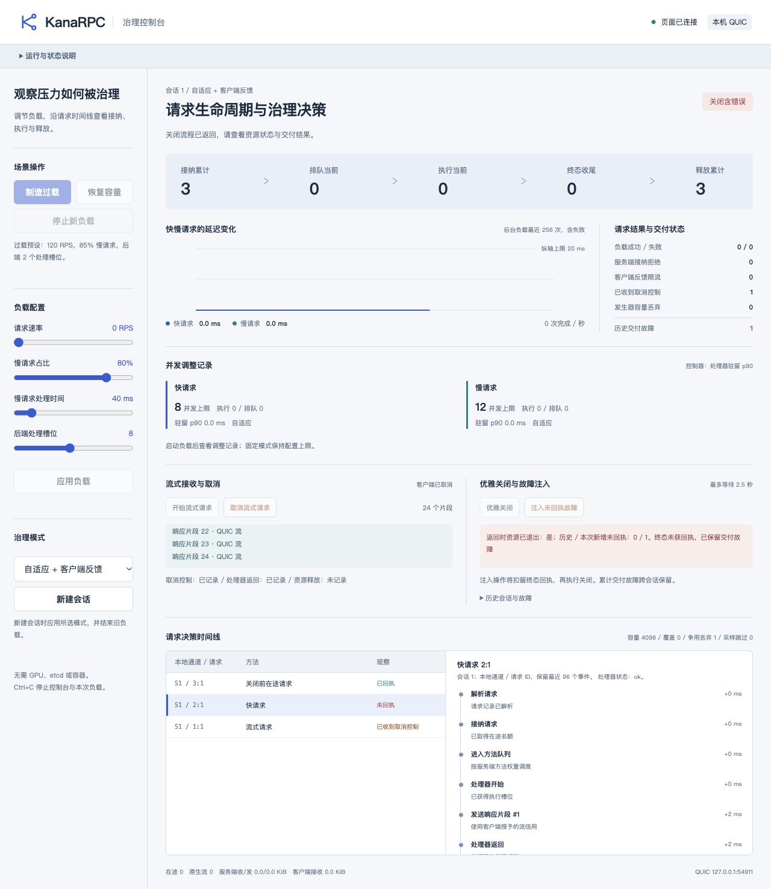

# 项目文案审查与验证

范围：KanaRPC 的 README、ORIGINS、14 份既有技术指南、治理控制台静态页面、动态状态与命令行提示。新增集中使用说明和验证索引。RPC 协议、调度、资源治理及 CampusTrace 代码保持原状。

## 主要修改

- README 以能力、启动、接入和架构为主线，阶段数据通过验证索引查阅。
- README 开场与操作引导加入轻松语气和少量颜文字，技术说明、使用约束与许可保留准确表述。
- 来源说明集中记录沿革、第三方依赖与许可，保留旧 fork 关系及接触经历。
- 技术文档保留计数、预算、失败与兼容契约，删除重复声明和会话式解释；修正连接管理与编码前接纳的过时描述。
- 控制台统一使用“治理控制台、处理器、优雅关闭”等术语；空状态直接给出操作指引，已知诊断在展示层翻译，API 原始错误与状态键保留。
- ACK、事件采样、验证环境与本机访问要求归并为可展开说明。取消控制、处理器返回与资源释放继续独立展示。

## 典型前后对比

| 原表达 | 修改后 |
| --- | --- |
| 上下文优先的实验 Go RPC 框架 | 以请求生命周期与资源治理为核心的 Go RPC 框架 |
| 记录已解析；不等于已接纳 | 请求记录已解析 |
| 客户端协议层 ACK；不是业务提交 | 收到客户端协议回执；业务责任集中说明 |
| 实验请求未取得回执义务，没有伪造未回执 | 请求未进入回执等待状态，请在可用会话中重试 |
| 不是生产框架 | 具体部署要求、资源范围与环境验证状态统一列入使用约束 |

## 验证结果

- 全模块构建通过；控制台 vet 通过。
- 既有记录器、取消/回执、访问控制/重复操作与根包 Example 的针对性 race 检查通过，见 [race 输出](race.txt)。
- 最终 race 二进制通过 7 步 HTTP + QUIC 流程：启动、过载、流式接收、取消、正常关闭、未回执关闭和跨会话历史保留，见 [运行结果](walkthrough-result.json) 与 [状态摘要](runtime-summary.json)。两个 walkthrough 均通过，运行命令见 [首轮](commands.json) 和 [最终轮](final-commands.json)。
- JavaScript 语法、组合错误展示、未知诊断保留与转义检查通过。页面 ID、表单配置、动作绑定和事件原因键保持一致；4 个 Go 文件的 AST 在忽略字符串与注释后相同，见 [静态检查](static-check.json)。
- 首轮链接检查先于检查收据生成，报告该文件缺失；调整生成顺序后通过。[首轮记录](static-initial.json) 保留为验证工具的执行记录。
- 浏览器实际检查折叠说明、流式取消及未回执故障。页面显示资源已退出，同时保留 1 次未回执故障；浏览器错误日志为空，见 [页面检查](browser-check.json) 与下方截图。一次事件争用丢弃在页面明确计数，资源释放“未记录”仍按观测缺口展示。

## 保留的约束与记录

[使用约束](../../operating-notes.md) 集中说明认证与授权、协作取消、租约与 RSS、协议回执、发现新鲜度、自适应配置及本地观测范围。真实双机、WAN、多成员 etcd、小时/天级负载和真实模型推理性能尚未验证。

既有阶段报告、原始数据、截图、压缩归档和校验文件保持原内容。R9A 吞吐退化、R9D 未稳定复现及候选撤回等记录保留在 [历史索引](../README.md)。本次检查聚焦文案与展示回归，未新增性能结论；最终源码文件摘要见 [manifest](source-manifest.json)。临时测试进程已退出。
