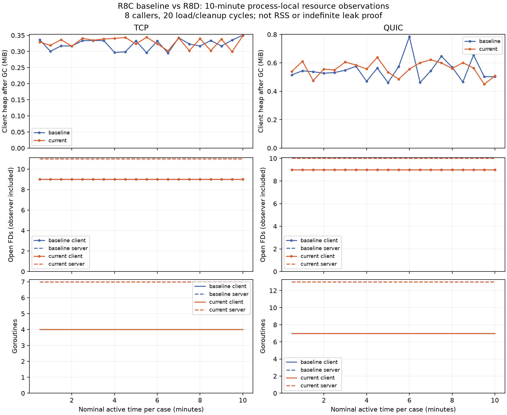

# R8D：本地与 Linux VM 验收

2026-10-31，本轮仅修改独立 KanaRPC；CampusTrace 和旧 KanaRPC-Go 未修改。基线 R8C `5b034ad`，实施步骤和复验入口见 [network-r8d.md](../../network-r8d.md)。本报告区分本机应用中继、Linux VM 内核注入和缺少环境的真实双机，不将 fixture 当推理或生产收益。

## D1/D2：超时根因、最小修复与负结果

具体包迹、碰撞机制、前后测试与范围见 [握手报告](handshake-report.md)。本轮捕获了纯 quic-go 与 RPC 各一次自然 dial 超时：双栈 wildcard 自动选的源端口与已有 IPv4 socket 重号，IPv4 服务端回复被已有 socket 收走，客户端持续重传至 3s 截止。自建 socket 的受控转交/握手测试确认机制后才修改运行时。

修复使 DialQUIC 在同一预算内先解析目标，保留 TLS hostname，显式创建目标同地址族的 UDP socket，覆盖失败、远端关闭和公开 Close 的回收。生产代码没有新增重试、TCP 降级或放宽 deadline；其余新增内容是诊断、测试和验证工具。

**负结果与限制保留**：自然背景的新旧 20,000 次样本都零失败，不能据此计算失败率改善；增加 64 个自有 IPv4 端口占用后，旧版计划 5,000 次、实际 1,489 次/3 失败触发停止，3,511 次未启动；新版实际 5,000 次/0 失败。没有把未启动数充当成功 offered。R8C 既往缺少包迹的每次超时仍不能逐次追溯归因。

第一次固定端口 bind 的夹具未复现自动端口选择问题，原日志保留，不计框架漏洞。Linux VM 原生快捷函数 5,000 次无失败，增加同样自有 IPv4 占用后也无失败；此控制支持平台差异的观察，不构成所有 OS/版本的结论。

## D3：网络故障与关闭边界

| 层级 | 实际验证 | 结果 / 证据 |
| --- | --- | --- |
| 独立 UDP 中继自测 | 实际丢弃、恢复、延迟、持有一个包时 Close、计数与缓冲上限 | race 10 轮通过：[中继单测](relay-unit.jsonl) |
| Mac QUIC 应用路径 | 无故障、2ms 单包转发延迟、双方向各丢一个包、32KiB/s 串行限速、反向黑洞中取消/恢复 | race 3 轮通过：[边界测试](network-boundaries-first.jsonl)；包计数实际触发，Echo 完整且不重放 |
| Mac 慢消费者 / drain | 信用耗尽的流不阻塞邻近普通 RPC；Close 回收未读结果；双向黑洞中 40ms drain 到期并取消服务端处理器 | 同上；局部注入不是 kernel netem |
| Linux VM 内核 netem | TCP/TLS/QUIC × 普通/16 块流 × 新旧 × 六 profile | **72 case、7,200 次实际测量 offered 全成功**，无同节点重复；关闭后连接、在途、执行、原生流、丢终态计数归零 |
| Linux VM 100% 内核丢包 | 已接纳请求之后丢弃 lo 全部包，本地取消先返回，远端未收到取消，然后 40ms 截止 drain | TCP/TLS/QUIC 各执行一次；约 40ms 返回 DeadlineExceeded，强制取消后资源归零：[内核取消/drain](kernel-cancel-drain.log) |
| Linux VM 正常取消 / IPv6 / DNS / fd | 当前 root 包完整正常测试；Darwin 专属碰撞测试不适用 | 171 pass / 2 skip / 0 fail：[完整日志](full-linux.log)；两个 skip 为 Darwin 专属碰撞用例。此处是 root 包，不包含 Linux etcd 全矩阵；Linux race 未运行 |

内核 profile 为 baseline、delay 10ms、loss 2%、delay 10ms + reorder 25%/correlation 50%、rate 256kbit、delay 20ms + loss 1% + rate 512kbit。每 case 独立容器、两进程共享同一个 lo/netns，GOMAXPROCS=2、4 个闭环调用者，64 次 warmup 后测量 100 次；版本顺序交替。保存实际 qdisc 字节/丢弃计数、所有 offered、镜像/源码/二进制 hash。

该实验是真实 Linux 7.0.12-linuxkit 的内核注入，**不是物理双机、真实 NIC 或互联网拓扑**。TCP GSO/skb 与 QUIC datagram 的排队单位不同；内核随机丢包/重排未设种子。主机同时有资源观察，计时只说明本组路径成本，不用来论证生产容量、普遍 QUIC 优势或修复的吞吐提升。

**首轮准备失败保留**：iproute2 6.1 不支持 `seed`，首轮 loss/reorder/combined 的 tc 命令在业务启动前失败；不计为 RPC 网络失败。保留 [原矩阵](kernel-controls.txt)、[语法探针](tc-seed-probe.txt)；控制器修复日志合并、增加 profile 预检并明确随机性后重新运行，未改 RPC 来绕过失败。

[完整新旧 profile 耗时/完成数 CSV](kernel-costs.csv)、[摘要](kernel-verified-summary.json)、[全部 offered/qdisc/日志](kernel-verified-raw.tar.gz)、[源码/二进制/镜像 hash](kernel-verified-metadata.json)均保留。每格是一组 100 个成功测量请求的 p95，非重复置信估计，也不将新旧的随机丢包轨迹当相同。

| Profile | 普通 TCP p95 ms 旧→新 | 普通 TLS p95 ms 旧→新 | 普通 QUIC p95 ms 旧→新 |
| --- | ---: | ---: | ---: |
| baseline | 1.457→0.459 | 0.379→0.310 | 0.546→0.413 |
| delay | 23.070→23.134 | 23.701→24.281 | 47.757→47.490 |
| loss | 3.915→0.285 | 0.325→0.334 | 0.530→0.470 |
| reorder | 44.125→45.319 | 46.572→43.507 | 43.850→42.035 |
| rate | 128.191→128.200 | 142.086→142.023 | 142.912→142.556 |
| combined | 119.963→108.684 | 115.558→134.057 | 149.985→152.264 |

原始准备失败矩阵为 36 PASS / 36 FAIL，实际测量 3,600 次，另 3,600 次计划请求未启动：[旧控制器](kernel-driver-initial.py)、[旧摘要](kernel-controls-summary.json)、[旧完整记录](kernel-controls-raw.tar.gz)。修正后的 [实际控制器](kernel-driver-verified.py)对应已记录 hash；其后仅为复验入口增加自动镜像架构选择，未把未实测的 amd64 计入结果。100% 丢包不是“远端取消已送达”：测试明确观察到远端仍在执行，随后靠服务端 drain deadline 取消，不能写成网络分区中取消仍立即送达。

## D4：资源观察与最终回归

资源运行使用同一新增 FD 观察器注入 R8C 基线与当前版本；每版本/传输 600 秒、20 轮负载/清理，四组共 2,400 秒名义活动窗口。负载包括 8 个调用者的普通、完整流、按计划取消流、已完成未读流；历史逐样本/逐阶段写 JSONL，不在测量进程保留请求 ID map 或采样数组。forced-GC heap、goroutine、FD 和全部预算按轮检查。

资源时间与主机上的其他正确性/VM 验证可能重叠，只解释本进程资源与归属，不比较这些运行的 throughput/CPU。历史驱动 scope 字符串误写 R8A，真实 `--baseline 5b034ad` 和 hash 明确是 R8C；[修正说明](resource-run-notes.json)保留原始 metadata，不篡改既有证据。

四轮最终完整矩阵：Go 1.27.1 普通/race 与最低 Go 1.26.0 普通/race 均 **241 pass / 0 skip / 0 fail**，每轮独立真实 etcd 3.7.1 单成员；[普通](final-test/result.json)、[race](final-race/result.json)、[最低普通](final-min-test/result.json)、[最低 race](final-min-race/result.json)。包含子用例与 fuzz seeds；有限 race/fuzz 不证明不存在其他竞争。独立 SDK 和 vet 另有记录。

长测四组和 80 个清理点全部通过，合计 **29,350,275 个按计划完成的混合操作**。其中包括按计划取消的流，不等于所有 RPC 业务终态均为 OK。各轮 client/server 的所有池 Used=0、Peak≤Limit；完成未读流在 Close 前确认 Receive.Used>0，随后释放。最终 worker Connections/InFlight/Executing/NativeStreams/LostTerminals/IncompleteExchanges 均为零。

| 版本/传输 | 完成混合操作 | client heap KiB 范围 | FD client/server | goroutine client/server |
| --- | ---: | ---: | ---: | ---: |
| baseline/tcp | 11,883,615 | 301.8–358.7 | 9/11 | 4/7 |
| current/tcp | 11,143,477 | 306.7–356.7 | 9/11 | 4/7 |
| current/quic | 2,849,651 | 460.7–653.7 | 9/10 | 7/13 |
| baseline/quic | 3,473,532 | 472.3–803.1 | 9/10 | 7/13 |

[资源摘要](resource-summary.json)、[逐轮 CSV](resource-curves.csv)、[全部 JSONL/原始记录](resource-raw.tar.gz)、[当时源码](resource-sources.tar.gz)、[metadata](resource-metadata.json)保留。FD 包括固定观察器文件；四组各 20 点的 FD 和 goroutine 均为常数，没有用宽松差值隐藏增长。GC 后 heap 在此窗口波动，没有观察到单调累计，仍不能排除低速泄漏或推导 RSS 上限。

图由 [后处理脚本](../../../scripts/summarize-resources.py)在测量进程全部退出后用 matplotlib 生成；[SVG](resources.svg)可导出，横轴为名义活动窗口，不含预热和阶段清理。matplotlib 仅安装在 /tmp 验证环境，未加入项目依赖。

其他最终检查：FuzzQUICLiteralAddress 配置 15s/2 workers，**17,410 executions PASS**：[日志](fuzz-address.jsonl)；[vet](vet.txt) PASS；[独立消费模块](sdk/result.json)用公共 API、GOWORK=off、race 3 轮通过。有限 fuzz 未发现的问题不能写成不存在。

## 全部其他验证结束后的串行性能对照

四组资源运行、Go/etcd/SDK 和 Linux VM 工作全部结束后，先完成资源校验与画图，再串行运行以下两组，期间不运行其他 Go 测试。Go 源码/模块 hash 跨两组一致，冻结源码见 [归档](final-sources.tar.gz)。race 计时、前面的资源/VM 混合时段均不作性能证据。

1. **新旧普通/流式传输**：同一 transport-lab driver，R8C `5b034ad` 与最终版本，TCP/QUIC × 两负载 × 三个种子 × 两版本，共 **24 case / 72,000 offered 全成功**；GOMAXPROCS=2、8 个闭环调用者，64 次预热，按种子交替版本。p95 仅统计成功请求；pair CPU 为两个进程生命周期，含启动、预热和关闭。[摘要](serialized-transports-summary.json)、[全部 offered](serialized-transports-raw.tar.gz)、[源码 metadata](serialized-transports-metadata.json)、[传输二进制 hash](transport-binary-hashes.json)。

| 传输/负载 | req/s 旧→新 | p95 ms 旧→新 | pair CPU s 旧→新 |
| --- | ---: | ---: | ---: |
| tcp/unary | 50,368→56,215 (+11.61%) | 0.2665→0.2246 | 0.1955→0.1821 |
| tcp/stream | 10,981→10,768 (-1.95%) | 0.9483→0.9949 | 0.9217→0.9337 |
| quic/unary | 30,889→30,404 (-1.57%) | 0.3934→0.4090 | 0.3117→0.3094 |
| quic/stream | 14,686→14,473 (-1.45%) | 0.7581→0.7836 | 0.6596→0.6670 |

QUIC 普通/流式吞吐分别下降约 1.6%/1.5%，对应 p95 上升；TCP 流式也有负变化，全部保留。TCP 普通请求出现 +11.6%，但其运行路径未修改，不能归功于 QUIC 修复。只有三个短重复且没有置信区间/完整 profile，不能把单组差异解释为可靠的通用性能收益，也不能只挑正变化展示。

2. **连接管理强基线**：两个真实 worker + 一个 client、两个固定 Snapshot fixture endpoint；direct 两条直接复用、dial 每次拨号、managed 两条管理连接、churn 两节点只配一条。TCP/QUIC × 两负载 × 四策略 × 三种子，共 **48 case / 48,000 offered 全成功，零准备失败**。与此前失败样本分属不同运行，不把短样本零失败当成可靠性提升的统计证明。[摘要](serialized-routing-summary.json)、[全部 offered](serialized-routing-raw.tar.gz)、[源码/二进制 hash](serialized-routing-metadata.json)。

| 传输/负载 | direct req/s | managed req/s | managed 相对 direct | churn req/s |
| --- | ---: | ---: | ---: | ---: |
| tcp/unary | 56,757 | 54,164 | -4.57% | 31,405 |
| tcp/stream | 13,048 | 12,943 | -0.81% | 9,053 |
| quic/unary | 27,245 | 26,187 | -3.88% | 8,605 |
| quic/stream | 13,177 | 12,804 | -2.83% | 5,806 |

管理层开销与小连接池 churn 退化仍然存在，没有因这次 socket 修复自动消失；本轮 managed 的普通请求比 direct 低约 4%，churn 的 QUIC 普通请求约低 68%。固定发现视图、整数和 JSON fixture 不是真实 etcd 传播或模型推理性能。没有调用 vLLM。

验收结束后两份测试文件仅做 gofmt，运行时与模块 hash 未变，并重跑了对应 race 用例：[格式化差异清单](formatting-receipt.json)、[补验](formatted-tests-regression.jsonl)。实测源码归档不改写，最终源文件清单另记格式化后的版本。

## 未验证与下一步

- **未验证**：真实 Linux 双机、不同物理 NIC/MTU、真实 WAN RTT/丢包/带宽、小时/天级压力、生产流量、etcd 多成员分区，以及真实 vLLM/GPU 推理性能。当前 Linux 是 Docker 本地 VM；arm64 已运行，工具自动选择 amd64 的分支尚未实测。
- **仍有设计风险**：用户 codec 可阻塞/任意分配，字节预算不是 RSS 硬限额；遗忘未读流必须显式归还；池总潜在字节占用随连接数放大；固定退避缺少 jitter；最后一次发现检查与真正发送之间仍可更新；本次客户端修复不统一改变服务端 wildcard/双栈策略。
- **生产下一步三项**：用真实双机和更长故障负载复验 qlog/FD/drain；补池级共享字节预算与退休对象统计；降低发现快照复制和小连接池 churn 成本，同时继续保留 direct reuse 的强基线。身份认证/方法 ACL 与业务幂等仍须单独设计，协议 ACK 不是数据库提交或 exactly-once。
